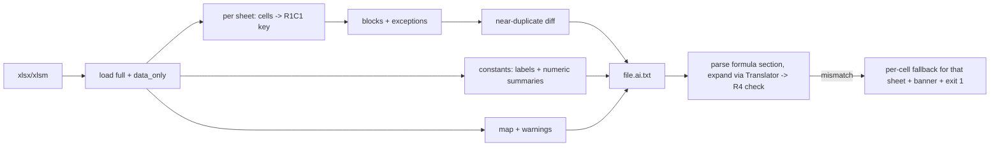

# excel-ai v1 Converter - Plan

## Goal Capsule

- **Objective:** one self-contained script, `excel_ai.py`, turns an `.xlsx`/`.xlsm` financial calculator into a compact UTF-8 text file. An AI can read that file fast and understand the workbook's logic from it.
- **Authority:** Product Contract R-IDs own behavior. KTDs own mechanism. Units own neither.
- **Stop conditions:**
  - Stop and report if the round-trip check (R4) cannot reach 100% on the synthetic fixture.
  - Stop and report if a settled decision (KTD1-KTD3) turns out infeasible.
  - Stop and report if the real-workbook check misses the size target. Include the per-section token breakdown in the report.
- **Execution profile:** Standard. Four units, sequential.

---

## Product Contract

### Summary

`excel_ai.py` replaces `medir_tokens.py`. It writes a text file with four parts:
- **warnings:** what the reader should not trust blindly
- **workbook map**
- **formula blocks:** grouped by repeated pattern, each block with its exceptions
- **constant data:** text labels kept, numeric runs summarized

On stdout it prints the token measurement: raw cell-by-cell, then the new output.

### Problem Frame

AI tools read spreadsheets one of two ways:
- **value-only:** the formulas are lost
- **cell by cell:** a real calculator measured 1.6M tokens

Grouping formulas already measured about 10x smaller than cell by cell. Most of what remains is raw numeric data, plus near-duplicate sheets.

### Requirements

**Output content**
- R1. Map: per sheet, list name, used range, hidden flag, formula count, and the sheets it references. Also list Excel tables (name, range, columns) and defined names (name and target).
- R2. Formula section:
  - Each block is a range plus the A1 formula of its first cell, with `_xlfn.`/`_xlws.` prefixes stripped.
  - When a run of one pattern is interrupted by single deviating cells (another formula, a constant, or a blank), it renders as one block followed by an exception line per deviating cell.
  - Array formulas render as their own blocks, marked as arrays.
- R3. Data section: text constants are kept verbatim. Numeric runs larger than a named threshold collapse to range, count, min/max, and the first few values.
- R4. Lossless formulas:
  - Expanding the written formula section reproduces every original formula cell.
  - The comparison is made after the same prefix stripping is applied to the originals.
  - If a sheet fails this check, the tool falls back to per-cell formulas for that sheet, writes a banner in the file, and exits non-zero.

**Warnings**
- R5. The warnings part lists:
  - `#REF!` counts per sheet
  - cached error values per sheet
  - formula blocks using `OFFSET`/`INDIRECT` (dynamic references)
  - a VBA project inside the file, since values may be written by macros
  - data-table (what-if) cells, which are not expanded
- R6. A sheet whose formulas mostly equal an earlier sheet's renders as "same formulas as X" plus only its differing formula cells. Its data section is always rendered in full.

**Delivery**
- R7. Usage is `python excel_ai.py file.xlsx`.
  - It writes `file.ai.txt` next to the input.
  - Stdout prints the token totals (raw and new), the reduction factor, a per-section breakdown, and the round-trip result.
  - Errors go to stderr.
  - Running with no argument runs the self-test.
- R8. Runs fully local, with no network access.

### Success Criteria

- On the user's real calculator, run locally outside the repo:
  - the R4 round-trip is 100%
  - total output is under 60k estimated tokens
- An AI reading the output can say what each sheet computes. This is checked by hand on the real output.

### Scope Boundaries

- Not included in v1:
  - `--mask` value masking
  - a cell-level `trace` command
  - cell-level input/output detection
  - an MCP server
  - JSON output
  - recalculation
  - macro analysis
- Cell-level dependency analysis is unreliable when `OFFSET` dominates, so v1 stays at sheet-level dependencies.

---

## Planning Contract

### Key Technical Decisions

- KTD1. Single file `excel_ai.py`: ASCII source, openpyxl as the only dependency, Python 3.8 syntax. `medir_tokens.py` is folded in and deleted. (session-settled: user-directed -- chosen over a multi-file package: the user copies the code by hand onto a work machine and cannot download zips)
- KTD2. The repo stays public. No real workbook, real sheet name, or real output is committed. `.gitignore` covers `*.xls*` and `*.ai.txt`, and tests use synthetic fixtures only. (session-settled: user-directed -- chosen over a private repo: the user needs access from work)
- KTD3. No network calls anywhere. (session-settled: user-approved -- chosen over an external service: the workbooks hold confidential financial data)
- KTD4. Two independent implementations cross-check each other:
  - **Grouping key:** the relative R1C1 form from `relativa()`.
  - **Expansion:** openpyxl's `Translator`, which already shifts A1 formulas while respecting `$`, sheet names and strings.
  - If the two disagree on an edge case, R4 catches it.
  - `relativa()` must be hardened:
    - Operands containing `[` (structured refs) and bare defined names are left verbatim.
    - Only operands that fully match a cell, range, column-range or row-range ref are converted.
    - Whole-column (`B:B`) and whole-row (`2:2`) ranges are made relative too.
- KTD5. The workbook is loaded twice:
  - **full mode:** for tables, defined names, hidden state, and array/data-table formula objects
  - **`data_only` read-only:** for cached values

  A full load of a large real calculator measured about 9s.
- KTD6. Per sheet, the grouping direction (vertical or horizontal) with less rendered text wins. Exception lines are counted in that comparison.
  - A run continues across a single deviating cell when the cells on both sides share the run's pattern.
  - A run cannot continue across two or more adjacent deviating cells.
  - The block range spans its exception cells. At expansion, each exception line overrides its cell.
- KTD7. Near-duplicate detection compares per-cell raw formulas against an earlier sheet at the same addresses. At 80% or more equal formula cells, the sheet renders as a diff. This comparison does not depend on grouping direction.
- KTD8. The output file is written in UTF-8. Stdout stays ASCII, so Windows cp1252 consoles cannot crash.
- KTD9. Tunables are named module constants: the numeric-run threshold, the sample size, and the duplicate ratio.

### Assumptions

- Formulas are stored in English with comma separators. This is the xlsx format regardless of the Excel UI language.
- The token estimate stays at 4 characters per token, as in `medir_tokens.py`. It is used for ratios and as a rough absolute figure.

### High-Level Technical Design

---

## Implementation Units

### U1. Core formula rendering with round-trip check

**Goal:** create `excel_ai.py` with:
- formula blocks in A1 form, with exceptions and arrays
- prefix stripping
- the R4 check run against the rendered text

**Requirements:** R2, R4. KTD1, KTD2, KTD4, KTD6, KTD8.
**Dependencies:** none.
**Files:** `excel_ai.py` (new), `medir_tokens.py` (delete after porting), `.gitignore` (new).
**Approach:**
1. Port the following from `medir_tokens.py`, then harden `relativa()` per KTD4:
   - `relativa()`, `blocos()`, `texto_formula()`
   - the raw cell-by-cell text builder
   - `tokens()`
2. Extend `blocos()` with the exception rule (KTD6).
3. Expansion parses the rendered formula lines and shifts each block's first formula with `Translator`. The check compares the result to the prefix-stripped originals.
4. Data-table formula objects are skipped by R4 and counted for R5.
5. The self-test builds synthetic workbooks in memory. It renders them, expands them, and asserts equality.

**Test scenarios** (self-test inside `excel_ai.py`):
- `=B2*C2` in E2:E361 renders as one block `E2:E361 =B2*C2` and expands to 360 matching formulas.
- Mixed `$` refs (`=B2*$A$1`, `=$B2*B$1`) group and expand correctly.
- Quoted sheet names with digits and spaces (`='Plan 1'!B2`) shift only the ref part.
- String literals that look like refs (`="B2"`) stay unchanged.
- Structured refs (`=Tabela1[CDI2024]`, `=Tabela1[[#This Row],[A1]]`) stay verbatim in the key and in the expansion.
- A defined name `TAXA2024` stays verbatim.
- `=SUM(B:B)` copied across columns and `=SUM(2:2)` copied down rows group correctly and round-trip.
- `_xlfn.XLOOKUP` renders as `XLOOKUP`, and the round-trip passes.
- A horizontal run (months across columns) groups horizontally.
- A 100-row run renders as one block plus one exception line in each of these cases, and round-trips:
  - one different formula in the middle
  - one hardcoded constant in the middle
  - one blank in the middle
- Two adjacent deviating cells split the run into separate blocks.
- An array formula renders as an array block and round-trips.
- A deliberately corrupted rendered line triggers the per-cell fallback and banner for that sheet.

**Verification:** the self-test passes.

### U2. Constant data sampling

**Goal:** the data section keeps text labels and summarizes numeric runs.
**Requirements:** R3. KTD9.
**Dependencies:** U1.
**Files:** `excel_ai.py`.
**Approach:**
1. Text cells are emitted verbatim, with adjacent cells of a row joined on one line.
2. Numeric constants group into runs along the sheet's chosen direction.
3. A run above the threshold prints range, count, min/max and the first few values. A smaller run prints in full.

**Test scenarios:**
- A header row of 6 labels is kept verbatim.
- A 300x10 numeric block prints as summary lines with the correct min, max and count.
- A 3-cell numeric premise block (rate, principal, grace period) prints in full.
- Dates print as ISO dates.

**Verification:** the self-test passes.

### U3. Map, warnings, and near-duplicate sheets

**Goal:** produce the map (R1), the warnings (R5), and near-duplicate sheet diffs (R6).
**Requirements:** R1, R5, R6. KTD5, KTD7.
**Dependencies:** U1.
**Files:** `excel_ai.py`.
**Approach:**
1. Sheet references are taken from the part of each ref operand before `!`, with quotes removed. External-workbook prefixes (`[n]`) are reported separately.
2. Tables come from `ws.tables`. Defined names come from the workbook in full mode.
3. VBA detection checks for `xl/vbaProject.bin` with `zipfile`.
4. Cached errors are values starting with `#` in the `data_only` load.

**Test scenarios:**
- A sheet referencing two other sheets, one with a quoted name containing a space, lists both in the map.
- A hidden sheet is marked hidden.
- A defined name appears in the map with its target.
- A table appears with its name, range and columns.
- A formula containing `#REF!` is counted under its sheet.
- A block using `OFFSET` is tagged as a dynamic reference.
- A copied sheet with one changed formula renders as "same formulas as X" plus that one cell. Its changed input constant still appears in its data section.
- A zip containing `xl/vbaProject.bin` triggers the macro warning. A plain `.xlsx` does not.

**Verification:** the self-test passes.

### U4. CLI, measurement, and README

**Goal:** wire up R7 and update the docs.
**Requirements:** R7, R8. KTD1, KTD8.
**Dependencies:** U1, U2, U3.
**Files:** `excel_ai.py`, `README.md`.
**Approach:**
1. `main` writes `<input stem>.ai.txt` next to the input, in the part order given in the Summary.
2. It then prints, ASCII only:
   - raw and new token totals
   - the reduction factor
   - the per-section breakdown (map, warnings, formulas, data)
   - the R4 result
3. The exit code is non-zero on any R4 fallback.
4. README gets copy-paste install and usage instructions in Portuguese, plus a raw-file link.

**Test scenarios:**
- Running with no argument runs the self-test and exits 0.
- Running on a fixture written to a temp dir creates `.ai.txt` and prints the totals and `round-trip: 100%`.
- A nonexistent path prints a one-line error to stderr and exits non-zero, with no traceback.

**Verification:**
- An end-to-end run on a synthetic fixture succeeds.
- `excel_ai.py` contains no non-ASCII byte.

---

## Verification Contract

- `python excel_ai.py` (self-test) exits 0.
- Synthetic fixture end to end: `.ai.txt` is written, and the round-trip is 100%.
- Real workbook, run outside the repo with nothing committed:
  - the round-trip is 100%
  - the estimate is under 60k tokens, or the stop condition is reported with the breakdown
- The ASCII check on `excel_ai.py` passes.
- `git ls-files` lists no `*.xls*` or `*.ai.txt` file.

## Definition of Done

- U1-U4 are done, and every self-test scenario is present and passing.
- `medir_tokens.py` is removed, and its behavior lives in `excel_ai.py`.
- No real workbook data appears in the repo, commits, or PR text.
- No dead or experimental code is left in the diff.
