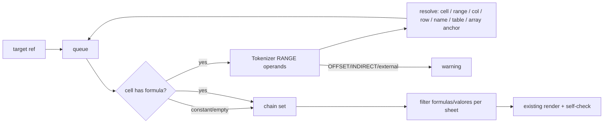

# feat: Precedent chain of one cell (`--celula`)

## Summary

`python excel_ai.py calc.xlsx --celula "'Resumo'!B5"` writes a dump with only the formulas and inputs that cell depends on, recursively across sheets, in the same compact format. The AI gets one calculation (e.g. the final IRR) without the rest of the workbook.

## Problem Frame

A full dump of a big calculator is about 30k tokens. Many questions are about one number ("why is the IRR 1.2%?"). Its precedent chain is usually a small fraction of the workbook, so a focused dump is cheaper and keeps the AI on the relevant math.

## Requirements

- R1. New optional CLI flag `--celula REF`, where REF is `'Sheet name'!B5`, `Sheet!B5` or `B5`. `B5` alone means the active sheet. `$` and lowercase are accepted. The sheet part is split on the last `!`, quotes are stripped, and the sheet is matched case-insensitively. The target must be one cell. A range, an unknown sheet or a bad ref prints an error and exits 2.
- R2. The chain covers every cell the target depends on, followed recursively:
  - single cells and ranges (`A1:B9`), including on other sheets;
  - whole columns and rows (`A:A`, `2:2`), limited to cells that exist;
  - defined names that point to a plain range;
  - structured refs: `Tabela1[Col]` resolves to that column's data. `[@Col]`, `[#This Row]` and other unqualified forms use the table that contains the formula cell. A bare table name, `[#All]` or a column that is not found falls back to the whole table. Table and name matching is case-insensitive.
- R3. A ref (cell or rectangle) that intersects an array formula's range pulls in the array's anchor. A per-sheet list of `(array rectangle, anchor)` is built at load, because openpyxl leaves non-anchor array cells empty.
- R4. These are listed in Warnings and not followed:
  - dynamic results (`OFFSET`/`INDIRECT`);
  - external-file refs;
  - data-table cells;
  - defined names that are not a plain range;
  - any operand that matches no cell, range, name or table, such as `#REF!`, a missing sheet, a LET variable or a fragment like `:B3`.

  Static range arguments inside `OFFSET`/`INDIRECT` are still followed. The resolver never raises; it records a warning and moves on.
- R5. In chain mode, Warnings, Map counts and the self-check count use chain formulas only. The Map lists chain sheets only, and Defined names lists only names the chain used. The console `bruto` baseline stays the full workbook, and the console also prints the chain/full token ratio. The output uses the existing format:
  - per-sheet `## Formulas` (blocks, labels, `except`) holds only chain formulas, and `## Data` holds only chain constants (the inputs);
  - sheets with nothing in the chain are left out;
  - the header names the target, its cached value, and the chain size (cells, sheets).
- R6. Gap cells inside a block that are not in the chain render as `except <cell> not in chain` (not `blank`). Header labels use the unfiltered constants and all formula positions, so a block still shows its header even when the header cell is not in the chain.
- R7. The self-check runs on the shown formulas; the per-sheet fallback still applies.
- R8. Output file: `<stem>.<sheet>_<cell>.ai.txt`. Sheet and cell are passed through `[^A-Za-z0-9]` -> `_` (ASCII only). The full dump file is not touched.
- R9. Real calculator: pick its final result cell. The chain must be 100% round-trip, finish in under 1 minute, and report its chain/full ratio. A ratio near 1 is reported honestly as the whole-column fan-out case, not hidden.

## Key Technical Decisions

- KTD1. Single ASCII file, openpyxl only, Python 3.8 (session-settled: user-approved — chosen over multi-module package / extra deps: user copies one .py by hand at work).
- KTD2. Public repo, no real workbook data or names in tests (session-settled: user-directed — chosen over committing the real calculator as fixture: work files confidential).
- KTD3. No network (session-settled: user-approved — chosen over any remote call: financial data stays local).
- KTD4. Lossless self-check stays for whatever formulas are shown (session-settled: user-approved — chosen over dropping verification: AI must trust the text).
- KTD5. Reuse `converter()` with an optional target. Load once, compute the chain set of `(sheet, row, col)`, then filter each sheet's `formulas`/`valores` before the existing rendering. Rejected: a separate renderer, because it would duplicate the format.
- KTD6. Ref parsing reuses openpyxl `Tokenizer` operands of subtype RANGE, as `relativa()` does. Range lookup uses a per-sheet `column -> sorted rows` index plus `bisect`, so large ranges and whole columns never scan every cell.
- KTD7. `blocos()` gains one optional `contexto` = (all formula positions, unfiltered constants), used only by `rotulo()`. The gap and `except ... value` text use the filtered `valores` plus the `buraco` text. With no `contexto`, normal mode is unchanged.
- KTD8. CLI parsing stays `sys.argv` by hand (two shapes). Rejected: `argparse`, which is heavier and gives no benefit for one flag.

## High-Level Technical Design

## Implementation Units

### U1. Chain resolver

**Goal:** given the workbook data and a target, return the chain set and the warnings.

**Requirements:** R2, R3, R4, KTD6

**Dependencies:** none

**Files:** `excel_ai.py`

**Approach:**
0. `converter()` first collects every sheet's `formulas`/`valores`/`cache`, then renders. In normal mode the output is unchanged.
1. A helper parses one formula's RANGE operands into `(sheet, ref text)`. It strips the sheet prefix and quotes, and marks `[` operands as structured or external.
2. A helper resolves one operand into cells. Kinds:
   - cell;
   - rectangle;
   - whole column or row (via the index);
   - defined name (a simple destination only);
   - table column;
   - array anchor.
3. A BFS over a queue with a visited set. Constants and empty cells join the set without expanding.

**Test scenarios:**
- Target `=B2*C2` on the same sheet pulls in B2 and C2 and their own precedents.
- A cross-sheet `Premissas!$B$2` pulls in that cell.
- `XLOOKUP("Taxa",Premissas!$A:$A,Premissas!$B:$B)` pulls in every existing cell of columns A and B on Premissas, and nothing else on that sheet.
- A defined name `TAXA2024` pulls in `Premissas!B1`.
- `SUM(Tabela1[Valor])` pulls in that table's Valor data cells.
- A ref to a cell inside an array range pulls in the anchor.
- `OFFSET(...)` adds a warning, and its arguments are still followed.
- A cycle (A1 = B1, B1 = A1) ends without looping.
- `INDIRECT("A1")` adds a warning.
- A ref to a missing sheet adds an unresolved warning without raising.
- A `[@Valor]` ref inside a table row pulls in that table's Valor column.
- A whole-column ref over an array column pulls in the anchor.

**Verification:** the resolver returns exactly the expected set on the fixture.

### U2. Filtered rendering and CLI

**Goal:** a `--celula` run writes the focused dump.

**Requirements:** R1, R5, R6, R7, R8, KTD5, KTD7, KTD8

**Dependencies:** U1

**Files:** `excel_ai.py`, `README.md`

**Approach:**
1. `converter(fonte, alvo=None)`: when `alvo` is set, build the chain after loading, filter per sheet, skip empty sheets, pass all formula positions to `blocos()` and use the `not in chain` gap text, and add the target line to the header.
2. `main(caminho, alvo=None)` picks the output name.
3. `__main__` accepts `file --celula REF`.
4. README gets a usage line.

**Test scenarios:**
- On the fixture, the `--celula` output for a cell in the Fluxo D column shows the D block, its B/C precedents, and Premissas inputs. It does not show Meses.
- A non-chain formula in the middle of a run renders as `except ... not in chain`, and the self-check passes.
- Normal mode output is unchanged (existing asserts still pass).
- A chain block still shows its `[label]` when the header cell is not in the chain.
- The chain-mode Map lists only chain sheets.
- A range target gives exit 2.
- A bad sheet name gives exit 2; a constant target gives a dump with just that value.

**Verification:** self-test passes; real-file run per R9.

## Scope Boundaries

### Deferred to Follow-Up Work

- Dependents (who uses this cell), the reverse direction.
- Evaluating OFFSET/INDIRECT with cached values.
- Several targets in one run.

## Assumptions

- LET/LAMBDA variable names show up as unresolved warnings. This is a known false positive, accepted to keep the resolver simple.
- Names and table refs with a sheet scope are resolved by name only. That is rare in the user's calculators.
